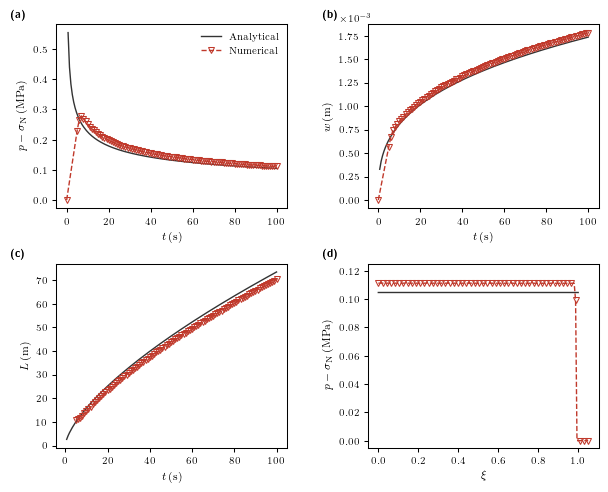
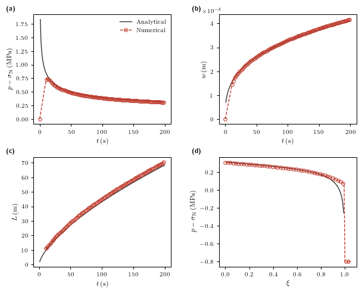
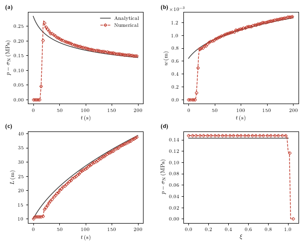

# hydraulic-fracture-benchmarks
Benchmarks and Jupyter notebooks comparing numerical results to analytical KGD solutions; later extension to other hydraulic-fracture problems

## Benchmark datasets

- `data/K_vertex/` — $\mathrm{K}$-vertex benchmark results, including numerical profile and time-series outputs for the selected case.
- `data/M_vertex/` — $\mathrm{M}$-vertex benchmark results, including numerical profile and time-series outputs for the selected case.
- `data/K_leakoff_vertex/` — $\widetilde{\mathrm{K}}$-vertex benchmark results, including numerical profile and time-series outputs for the selected case.

## Hydraulic fracture results

The repository includes benchmark data for both $\mathrm{K}$-vertex, $\mathrm{M}$-vertex and $\widetilde{\mathrm{K}}$-vertex cases. These results capture the evolution of the fracture geometry and can be compared directly with the analytical solutions used in the notebooks.

- $\mathrm{K}$-vertex results:
  - `data/K_vertex/numerical_profile_t100.csv`
  - `data/K_vertex/numerical_timeseries.csv`
- $\mathrm{M}$-vertex results:
  - `data/M_vertex/numerical_profile_t200.csv`
  - `data/M_vertex/numerical_timeseries.csv`
- $\widetilde{\mathrm{K}}$-vertex results:
  - `data/K_leakoff_vertex/numerical_profile_t200.csv`
  - `data/K_leakoff_vertex/numerical_timeseries.csv`

These datasets are intended to support visual inspection and validation of the fracture solutions in the associated notebooks.

## Figure gallery

Below are inline thumbnails for the result figures in the `figures/` directory. Click each image to open the full PDF.

  
  
  

- [KGD_toughness_results.pdf](figures/KGD_toughness_results.pdf) — summary plots related to toughness-dominated case.
- [KGD_viscous_results.pdf](figures/KGD_viscous_results.pdf) — summary plots related to viscosity-dominated case.
- [KGD_leakoff_toughness_results.pdf](figures/KGD_leakoff_toughness_results.pdf) — summary plots related to leakoff toughness-dominated case.

The thumbnails are stored in `figures/` as PNGs for quick preview in the README.